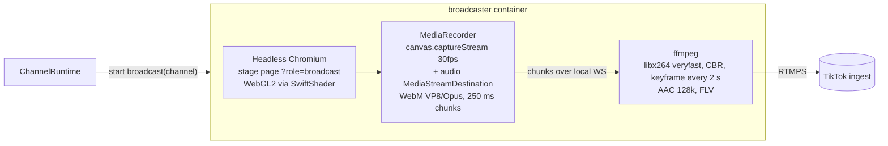

# ADR-0014: Cloud broadcast

**Status:** Proposed (the pipeline below is amended by [ADR-0020](0020-broadcast-pipeline-avx2.md))
**Date:** 2026-10-16
**Deciders:** Project owner

> **Superseded in part.** The rendering, capture and encoding pipeline in
> this record (SwiftShader, MediaRecorder, x264 transcode) was replaced by
> [ADR-0020](0020-broadcast-pipeline-avx2.md): Mesa llvmpipe, in-page H.264
> and a copy into FLV, at about 1.8 cores a stream instead of 3.7. The
> service split, control API, resilience, capacity cap and secrets handling
> below still apply.

## Context

In browser-source mode the creator's PC runs OBS (or TikTok LIVE Studio) with
the stage URL, so the stream depends on that PC staying on. "Fully
autonomous" ideally means no PC at all: the platform renders the stage and
pushes video straight to TikTok's RTMP ingest with the creator's stream key.

The spike (2026-10-16) established the constraints:

- Headless Chromium launched by `playwright-core` **under Bun** renders the
  WebGL2 stage using **SwiftShader** (software GL), with no GPU needed.
- `MediaRecorder` in that Chromium build supports **VP8/VP9 + Opus only, not
  H.264**. TikTok's RTMP ingest expects H.264 and AAC, so the server must
  **transcode** with ffmpeg (`libx264` is available).
- So each broadcast costs software GL rendering plus a full x264 encode: a
  CPU-heavy, per-stream workload.

## Decision

Offer cloud broadcast as a **beta, plan-gated feature** run by a separate
**`broadcaster` service**, so its CPU use can never starve the API or the
channel runtimes.

### Pipeline

- **Control:** the API asks the broadcaster (over an authenticated internal
  HTTP API on the compose network) to start or stop a broadcast for a
  channel. The broadcaster reports state (starting, live, retrying, failed),
  bitrate, dropped frames and CPU load. The runtime publishes these to the
  studio.
- **Rendering:** the stage page in `broadcast` role renders at **720x1280,
  30 fps** by default. It has a fixed frame clock and the quality governor
  locked at a configured level.
- **Encoding:** `ffmpeg -i pipe:0 -c:v libx264 -preset veryfast -tune
  zerolatency -b:v 3000k -maxrate 3000k -bufsize 6000k -g 60 -c:a aac -b:a
  128k -f flv rtmps://…`. Bitrate and resolution are plan-configurable.
- **Resilience:** if ffmpeg or Chromium exits, restart with backoff. On RTMP
  disconnect, reconnect and keep rendering. The stage keeps its state from the
  runtime, so viewers see continuity.
- **Capacity control:** `BROADCAST_MAX_CONCURRENT` per broadcaster host; a
  start beyond capacity is refused with a clear message.
- **Secrets:** the RTMP URL and stream key are stored encrypted
  ([ADR-0016](0016-security.md)), decrypted only inside the broadcaster process,
  and never logged. RTMP URLs are validated: `rtmp`/`rtmps` scheme only, and
  private and loopback addresses are rejected to prevent SSRF.

### Capacity estimate (to be measured in Phase 6)

| Resolution | SwiftShader render | x264 veryfast encode | ≈ vCPU per stream |
|---|---|---|---|
| 1080x1920 @ 30 | ~1–1.5 cores | ~1–1.5 cores | ~2–3 |
| 720x1280 @ 30 | ~0.5–0.8 cores | ~0.5–0.8 cores | ~1–1.5 |

**Measured (2026-10-16, Phase 6):** in a 4-vCPU container with no GPU,
one 720x1280 broadcast at 30 fps used about **2.5–3 vCPU** for Chromium
(SwiftShader rendering plus MediaRecorder's VP8 encode) and about **0.3 vCPU**
for the x264 transcode: higher than the estimate, because software
rendering of the full-screen atmosphere shader dominates. The default is
therefore `BROADCAST_MAX_CONCURRENT=1` per 4 vCPU next to the app, with the
broadcaster CPU-capped in compose. Ways to bring this down are listed under
Consequences. 1080p was not measured.

On a 4 vCPU VPS that means about one 720p broadcast alongside the app.
Broadcast-heavy customers need dedicated broadcaster hosts (the service is
already separate) or GPU instances.

## Options Considered

### Option A: Headless Chromium + MediaRecorder + ffmpeg transcode, in a separate service (chosen)

| Dimension | Assessment |
|---|---|
| Complexity | Medium to high |
| Cost | ~1–1.5 vCPU per 720p stream |
| Scalability | Horizontal: add broadcaster hosts |
| Team familiarity | Medium |

**Pros:** reuses the exact stage engine (pixel-identical to OBS); proven
building blocks; isolated from the API.
**Cons:** CPU-heavy; Chromium in a container needs care (fonts, shared memory, sandbox flags).

### Option B: Google Chrome stable (has H.264 MediaRecorder) with video passthrough

| Dimension | Assessment |
|---|---|
| Complexity | Medium |
| Cost | Saves the x264 encode (~half the CPU) |
| Scalability | Better per host |
| Team familiarity | Medium |

**Pros:** `-c:v copy` could skip transcoding.
**Cons:** MediaRecorder gives little control over keyframe interval and
bitrate, which TikTok ingest is sensitive to; Chrome licensing and
distribution in containers; still transcodes audio. **Worth a measured trial**
in Phase 6 before committing.

### Option C: Native renderer (GStreamer, Rust, or an ffmpeg filter graph) without a browser

| Dimension | Assessment |
|---|---|
| Complexity | Very high: reimplement the engine natively |
| Cost | Cheapest per stream at scale |
| Scalability | Best |
| Team familiarity | Low |

**Pros:** the efficient end state for hundreds of broadcasts.
**Cons:** two renderers to keep pixel-identical; months of work. This is the
"Rust media worker" from the v0.1 roadmap, justified only at scale.

### Option D: Don't offer cloud broadcast (browser-source only)

| Dimension | Assessment |
|---|---|
| Complexity | None |
| Cost | None |
| Scalability | n/a |
| Team familiarity | n/a |

**Pros:** nothing to operate.
**Cons:** creators must keep a PC running; weaker "fully autonomous" promise.

## Trade-off Analysis

A reuses the engine and ships the feature with known tools; its cost is CPU,
handled by plan gating, a concurrency cap and service isolation. B could halve
the cost and is cheap to try once A works. C is the long-term answer only if
broadcast becomes the dominant usage.

## Consequences

- Easier: a true "no PC needed" product tier.
- Harder: operating Chromium and ffmpeg in containers; capacity planning per host.
- Revisit: B after measurements; C if broadcasts exceed what a few hosts can serve.
- Cheaper rendering options to measure: lock broadcast quality to the
  governor's "balanced" level (85% render scale, upscaled by ffmpeg); a GPU
  host (VA-API or NVENC) for both rendering and encoding.
- Implementation notes: the broadcaster loads stage pages from the app
  over the private network, as `http://lantern-app:8080`. A bare `app`
  hostname doesn't work: `.app` is an HSTS-preloaded top-level domain, and
  Chromium forces it to HTTPS. Chunks travel from the page to ffmpeg over a
  Playwright binding (CDP), which isn't subject to the stage page's CSP.

## Action Items

1. [x] Phase 6 spike: measure CPU per stream at 720p and 1080p on the target VPS size, both SwiftShader and (if available) GPU (720p measured; see above).
2. [x] Build `apps/broadcaster` (internal API, Chromium lifecycle, MediaRecorder bridge, ffmpeg supervisor).
3. [x] Add the broadcast settings UI with stream key entry (write-only), test-connection, and the live status panel.
4. [x] Add RTMP URL validation (scheme, SSRF guard) and secret redaction in logs.
5. [x] Trial Chrome stable H.264 passthrough (Option B) and record the results in a follow-up ADR: done in [ADR-0020](0020-broadcast-pipeline-avx2.md), with WebCodecs rather than MediaRecorder.
