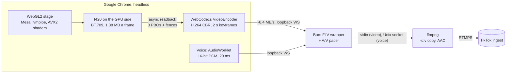

# ADR-0020: Broadcast pipeline for CPU-only AVX2 hosts

**Status:** Proposed
**Date:** 2026-10-16
**Deciders:** Project owner
**Amends:** [ADR-0014](0014-cloud-broadcast.md) (the service, API, security and capacity controls stay)

## Context

Cloud broadcast runs on ordinary VPSs: x86-64 CPUs with AVX2 and no GPU.
ADR-0014's first pipeline had Chromium render the stage with SwiftShader,
record it with MediaRecorder (VP8), and transcode it to H.264 with x264.
Measured on a 4-vCPU AVX2 container, one 720x1280 broadcast used **3.66
cores and still only delivered about 10 frames a second**: it couldn't run
in real time at all. The profile showed where the time went:

| Stage | Cost |
|---|---|
| Rendering a stage frame with SwiftShader (Subzero JIT, mostly 4-wide SSE) | 229 CPU-ms |
| Moving raw frames out of Chromium (41 MB/s at 30 fps), over any transport | ~1 core |
| MediaRecorder VP8 encode, then decode + x264 transcode | ~0.8 core |

## Decision

Rebuild the pipeline around what an AVX2 CPU does well, keeping the stage
page as the single renderer (pixel-identical to the browser source).

1. **Render with Mesa llvmpipe** (`--use-gl=angle --use-angle=gl-egl`,
   surfaceless EGL). LLVM compiles each shader into 8-wide AVX2 code and
   rasterizes on every core: **44 CPU-ms a frame instead of SwiftShader's
   229** on the same stage. `LP_NATIVE_VECTOR_WIDTH=256` pins AVX2 so
   AVX-512 hosts behave the same. lavapipe (Mesa's Vulkan rasterizer)
   measured the same cost and stays available as `BROADCAST_RENDERER=lavapipe`.
2. **Make the stage cheap to rasterize** (engine 1.1.0). The full-screen
   atmosphere renders at quarter resolution into a half-float target and is
   upscaled with a static dither. Static, so the encoder sees unchanged
   areas as unchanged. The halo moved into that pass, which shrank the orb's
   quad from 2.4 to 1.25 radii. Sprites with one texture take a
   single-sample path. Broadcast quality is locked to "high", so the governor
   never lowers the resolution of what viewers get. **44 → 21–28 CPU-ms a
   frame.**
3. **Convert and read back without stalling.** The stage draws into an
   offscreen target. Two small passes convert it to I420 (BT.709, limited
   range), so the readback is 1.38 MB instead of 3.7 MB of RGBA. Readback
   goes through a ring of three pixel buffers with fences, polled without
   blocking. A synchronous `readPixels` cost a full frame's render. Frame
   script time p95 went from 18 ms to 6.7 ms.
4. **Encode H.264 in the page** with WebCodecs (`VideoEncoder`, OpenH264 in
   Google Chrome; constrained baseline, constant bitrate, realtime mode, a
   keyframe every two seconds). About 0.4 MB/s leaves Chrome instead of
   41 MB/s, which removes the core of IPC that raw frames cost on any
   transport (WebSocket, worker, fetch and WebSocketStream all measured the
   same). Frames are encoded as they arrive, with timestamps counted in
   frames from the start. A timer re-encodes the last frame if the next one
   is late. That makes the stream exactly constant frame rate, without two
   30 Hz clocks drifting past each other.
5. **Copy, don't transcode.** The broadcaster wraps the encoded frames in a
   minimal video-only FLV, with `onMetaData` declaring the frame rate, and
   ffmpeg copies them (`-c:v copy`), encoding only the voice to AAC. Neither
   input is probed (`-analyzeduration 0 -probesize 32`). Both are fully
   described, and probing held every start and restart back by 5 s.
6. **Voice beside the video, paced together.** An AudioWorklet taps the
   voice as 16-bit stereo PCM at 48 kHz. Bun pushes it to ffmpeg over a Unix
   socket and fills underruns with silence, so audio never stalls the video.
   The voice is delayed to line up with the video's capture latency: 45 ms
   for H.264, 65 ms for raw frames.
7. **Fallback: raw frames into x264.** A browser without an H.264 encoder
   (Playwright's Chromium build) sends I420 frames. The broadcaster paces
   them through a small jitter buffer into x264 (`superfast`; x264 picks its
   AVX2 assembly at runtime). `VIDEO_ENCODER=x264` forces this path.
8. **One Chrome per broadcast.** Chrome runs all of a browser's WebGL
   through one GPU process, and llvmpipe blocks that process's main thread
   whenever a frame reads back what it just drew (the upscale, the YUV
   passes, the readback). Two stages in one browser therefore render one
   after the other. A browser per broadcast lets their frames overlap, and a
   crash takes down one broadcast instead of all of them. Each costs about
   380 MB of memory.
9. **Ship Google Chrome stable plus Mesa** in the broadcaster image. Chrome
   has the H.264 encoder; Mesa provides llvmpipe and lavapipe.

Two Chrome rules matter inside Compose, where the stage is served from
`http://lantern-app:8080`:

- **Secure context.** AudioWorklet and WebCodecs only exist in secure
  contexts, and plain HTTP on a private hostname isn't one. The broadcaster
  starts Chrome with `--unsafely-treat-insecure-origin-as-secure` for its
  configured `STAGE_ORIGINS`, and only those.
- **Local Network Access.** Chrome blocks a page on another address from
  reaching loopback, where the capture endpoint listens. The broadcaster
  grants `local-network-access` to the stage's origin only.

## Results

All measurements on a 4-vCPU AVX2 container with no GPU, 720x1280 at
30 fps, 3 Mb/s:

| | Before (ADR-0014) | After |
|---|---|---|
| CPU per broadcast | 3.66 cores | **1.66 cores** (lab stage); **1.82** (real stage in Compose, with the simulator driving it) |
| Frames delivered | ~10 a second | 30 a second; 0 repeated by the pacer after start-up |
| Stage render | 229 CPU-ms a frame | 21–28 CPU-ms a frame |
| From first frame to output | ~5 s | ~1 s |

Where the 1.82 cores go: Chrome's GPU process (llvmpipe) 1.12, the stage
page 0.52, ffmpeg 0.05, Bun 0.06, the rest of Chrome 0.07. llvmpipe's
thread count made no difference (2, 3 or one per CPU: 1.78–1.91 cores), so
it's left at Mesa's default.

Two broadcasts at once on the same 4 vCPU, which also runs the app, the
database and two RTMP servers, so the host is fully loaded:

| | Frames rendered per stream | Frames sent as repeats | Broadcaster CPU |
|---|---|---|---|
| One shared Chrome, first 30 s | ~23 a second | 24% | 2.98 cores, with 22% of the host idle |
| One Chrome per broadcast (chosen), first 30 s | ~27 a second | 13% | 3.36 cores |
| One Chrome per broadcast, the next 30 s | ~29 a second | 7% | |

The stream stays at exactly 30 fps either way: when a frame is late, the
encoder sends the previous one again. A 4-vCPU host still can't hold two
broadcasts cleanly. A dedicated host needs about 2 vCPU per broadcast; that
figure is extrapolated, not measured on a bigger machine.

Other paths measured on the way, for comparison:

| Pipeline | CPU |
|---|---|
| llvmpipe, MediaRecorder (VP8), x264 transcode | 2.9–3.5 cores |
| llvmpipe, raw I420 frames, x264 `superfast` (the fallback) | 2.76 cores |
| llvmpipe, WebCodecs H.264, copy (chosen) | 1.66 cores |

x264 on raw frames, pinned to AVX2: `veryfast` 0.58 cores, `superfast`
0.38, `ultrafast` 0.19, with the same SSIM (0.996) on this content.
OpenH264 at 3 Mb/s: SSIM 0.9958, PSNR 48.6 dB against the raw frames. x264
`veryfast` gets the same SSIM at 2.5 Mb/s (PSNR 50.5 dB). The stage is
simple, smooth content, and both are visually lossless at these rates.

The recorded output is H.264 Constrained Baseline 720x1280 at exactly
30/1 fps with AAC 48 kHz stereo, verified through the full Compose stack
into an RTMP server.

## Options Considered

### Option A: SwiftShader, MediaRecorder, x264 transcode (ADR-0014, before)

| Dimension | Assessment |
|---|---|
| Complexity | Low |
| Cost | 3.66 cores and not real time |
| Scalability | None on a 4-vCPU host |
| Team familiarity | High |

**Pros:** simplest. **Cons:** it doesn't keep up.

### Option B: llvmpipe, raw frames out, x264

| Dimension | Assessment |
|---|---|
| Complexity | Medium |
| Cost | 2.76 cores |
| Scalability | One stream per 4 vCPU |
| Team familiarity | Medium |

**Pros:** works with any Chromium build; full control of x264.
**Cons:** a core spent moving 41 MB/s out of Chrome. Kept as the fallback.

### Option C: llvmpipe, Chrome's MediaRecorder H.264, copy

| Dimension | Assessment |
|---|---|
| Complexity | Low |
| Cost | 2.9–3.5 cores |
| Scalability | Poor |
| Team familiarity | Medium |

**Pros:** little code. **Cons:** `canvas.captureStream` copies every frame
through the compositor. MediaRecorder sets its own keyframe interval and
bitrate behavior, which RTMP ingest is sensitive to.

### Option D: llvmpipe, in-page WebCodecs H.264, copy (chosen)

| Dimension | Assessment |
|---|---|
| Complexity | Medium to high (capture, encoder clocking, FLV wrapper, pacer) |
| Cost | 1.66–1.82 cores |
| Scalability | Twice the streams of B per host |
| Team familiarity | Medium |

**Pros:** about half the CPU of any other option. Explicit control over
bitrate, keyframes and timestamps. Nothing decoded or scaled anywhere.
**Cons:** needs Google Chrome (licensing, below), one browser per
broadcast (about 380 MB each).

### Option E: GPU host or a native renderer

Out of scope for CPU VPSs. ADR-0014 options C and the GPU note still apply
if broadcast becomes the dominant workload.

## Consequences

- One 720p broadcast fits next to the app on a 4-vCPU VPS with room to
  spare. A dedicated broadcaster host needs about 2 vCPU per stream
  (estimate; see Results).
- The image depends on **Google Chrome stable**, installed from Google's
  repository at build time. Its terms differ from Chromium's open-source
  licenses; see [decisions-needed #4](../decisions-needed.md#4-cloud-broadcast-capacity-and-price).
  Built without Chrome, the broadcaster falls back to option B by itself,
  with the Chromium in the base image.
- Chrome updates can change WebCodecs or Mesa behavior. The broadcaster
  logs a warning when the stage isn't rendering with llvmpipe, and logs
  capture and pacing counters every 30 s (frames, repeats, encoder
  overloads, readback latency).
- The engine has a software-rendering budget now: full-screen effects
  belong in the quarter-resolution atmosphere pass.

## Action Items

1. [x] llvmpipe in the image, AVX2 pinned; renderer check at start.
2. [x] Engine 1.1.0: quarter-resolution atmosphere, smaller orb quad, sprite fast path, quality locked in broadcast.
3. [x] GPU-side I420 conversion and non-blocking readback.
4. [x] In-page H.264, FLV passthrough, A/V pacer, raw x264 fallback.
5. [x] Verified through the Compose stack into an RTMP server, with one and two broadcasts.
6. [ ] Measure A/V sync end to end with a clap test on a real TikTok stream.
   The voice delays (45 ms for H.264, 65 ms for raw) come from measured
   capture latencies, not from an end-to-end measurement.
7. [ ] Measure 1080x1920. Expect about 2.2x the render and encode cost.
8. [ ] Measure several broadcasts on an 8-vCPU host to confirm the 2 vCPU per stream estimate.
