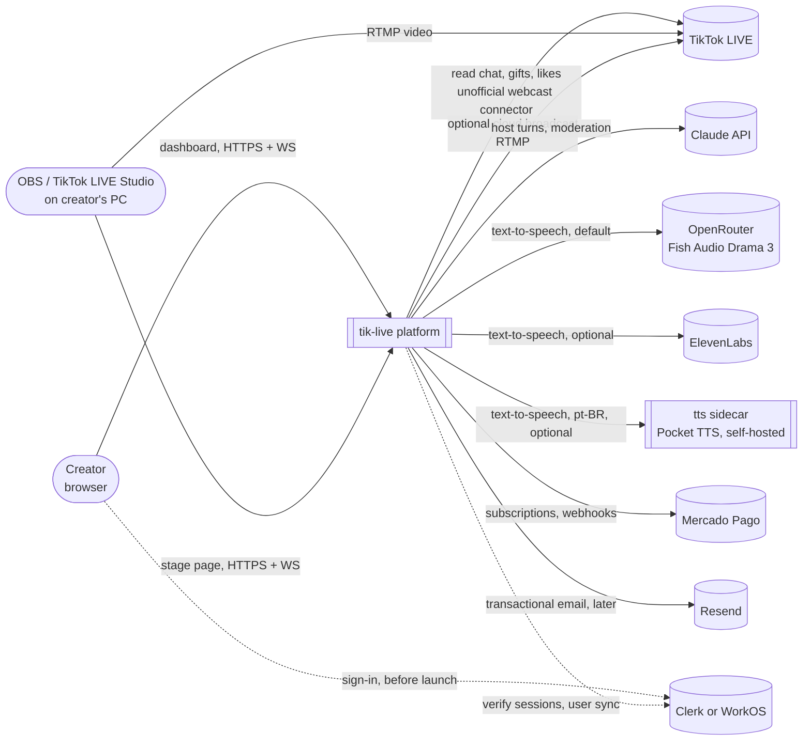
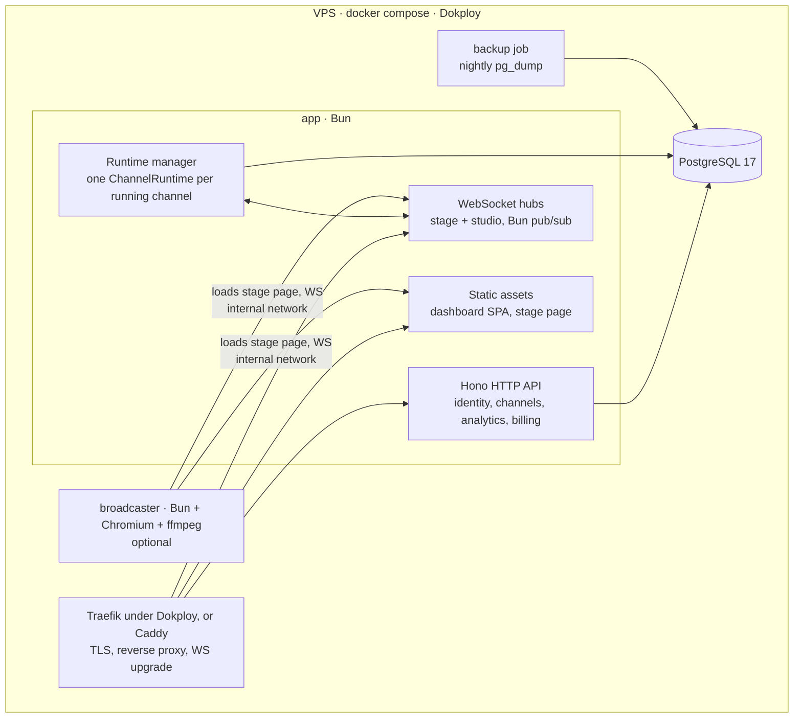
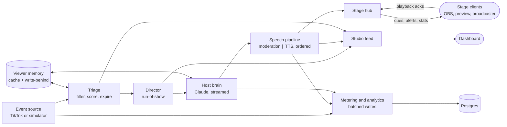
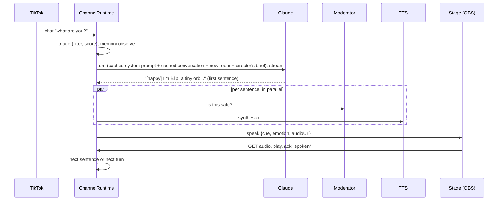
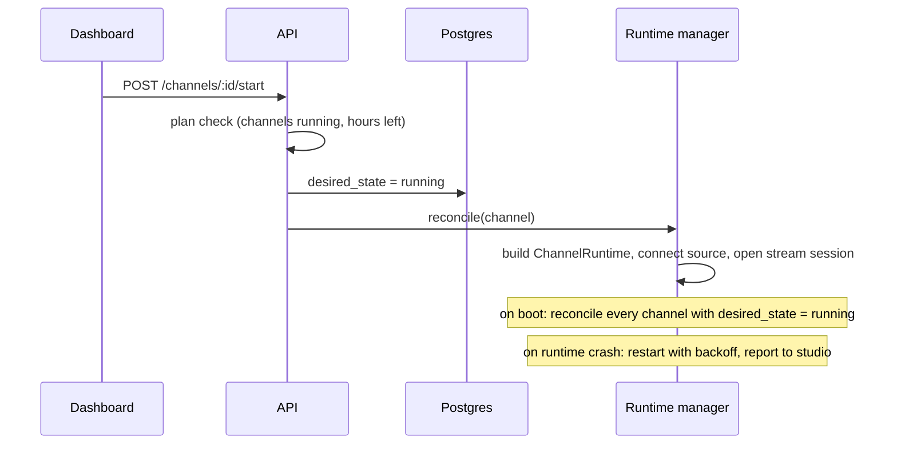
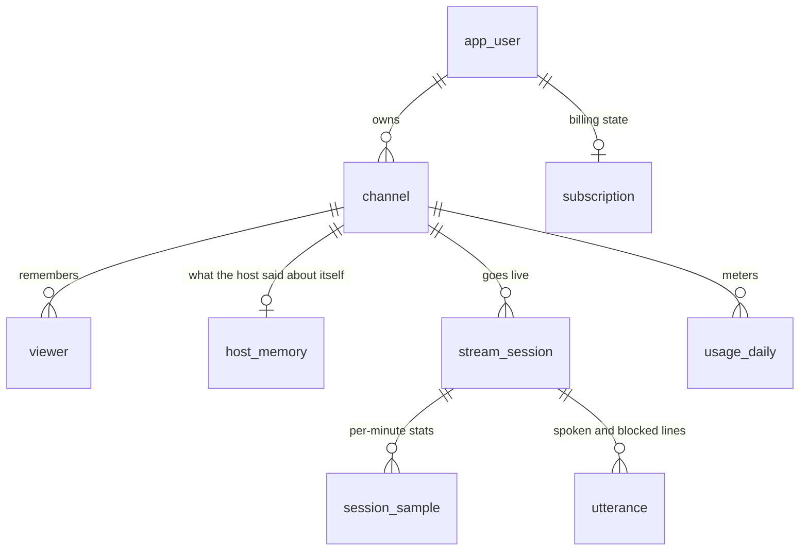

# Architecture overview

**Status:** Proposed · **Date:** 2026-10-16

## 1. What we are building

A multi-tenant SaaS that runs fully autonomous AI hosts on TikTok LIVE. A
creator signs up, designs a host character (personality, voice, look, show
segments, safety rules), connects their TikTok account, and goes live. The
platform reads the live chat, decides what to say, speaks through a rendered
character, and keeps the stream going without a human.

v0.1 (PR #1) proved the loop in a single-user Node process. This document
describes the production system that replaces it.

### Goals

1. **Autonomous by default.** A channel set to "running" stays running across
   server restarts, network drops and stream restarts, with no human action.
2. **Fast.** Chat-to-speech feels conversational; the stage renders at a
   locked frame rate in OBS; the dashboard responds instantly.
3. **Safe.** Nothing reaches the stream without passing input filtering and
   output moderation. One bad sentence can cost a creator their account.
4. **Simple to operate.** One VPS, one `docker compose up`, automatic HTTPS,
   nightly backups.
5. **Ready to charge for.** Accounts, plans, limits, usage metering and
   Mercado Pago billing.

### Non-goals for v1

- Horizontal scaling across many machines (the design leaves a path, see
  [ADR-0007](../adr/0007-channel-runtime.md)).
- Teams and shared workspaces (single owner per account in v1; the identity
  provider's organizations are the planned path).
- Sign-in during development. There is a built-in development user until
  Clerk or WorkOS is added before launch ([ADR-0018](../adr/0018-defer-authentication.md)).
- Mobile apps. The dashboard is responsive and works on a phone browser.
- Platforms other than TikTok.

## 2. Requirements

### Functional

| Area | Requirement |
|---|---|
| Identity | Development: a built-in dev user, switchable for multi-tenant testing, with a password gate for public staging servers. Before launch: sign-in through Clerk or WorkOS, with users provisioned on first visit |
| Channels | Create, edit, delete; TikTok handle; character (persona, segments, look, voice); safety settings |
| Runtime | Start, stop, pause (kill switch), resume, skip line, say a line, switch segment, inject test events |
| Studio | Live view of the stage, transcript, blocked lines, queue, stats, health, logs, all in real time |
| Stage | A per-channel browser-source URL for OBS / TikTok LIVE Studio, rotatable secret key |
| Broadcast | Optional cloud broadcast: the server renders the stage and pushes RTMP to TikTok (beta, plan-gated) |
| Analytics | Per-stream sessions: viewers over time, gifts and diamonds, messages, follows, top supporters, host activity |
| Billing | Plans with limits, Mercado Pago subscriptions (hosted checkout, plan changes, cancellation), usage metering, self-hosted mode with no limits |

### Non-functional

| Quality | Target (v1) | How we check |
|---|---|---|
| Chat-to-first-audio latency | p50 under 2.5 s, p95 under 4.5 s, measured server-side from event receipt to the first cue sent to the stage | Timestamps on every turn, reported in studio health |
| Studio update latency | Under 300 ms from server event to dashboard render | Event timestamps on the realtime channel |
| Stage frame rate | Locked 60 fps in OBS on a mid-range GPU; 30 fps in cloud broadcast | Engine frame-time telemetry sent to the server |
| Stage bundle | Under 60 KB gzipped (engine and stage page) | Build-size check in CI |
| Dashboard initial JS | Under 200 KB gzipped for the first route | Build-size check in CI |
| API latency | p95 under 50 ms for non-AI endpoints | Request timing logs |
| Recovery | A restarted server resumes every running channel within 10 s | Integration test plus a manual restart drill |
| Capacity (one 4 vCPU / 8 GB VPS) | 50 concurrent channels in browser-source mode; one 720p cloud broadcast next to the app (measured: about 1.8 vCPU each; two at once drop to about 29 fps on 4 vCPU, [ADR-0020](../adr/0020-broadcast-pipeline-avx2.md)) | Load test (Phase 7) and the broadcast spike (Phase 6) |
| Security | No cross-tenant reads or writes; secrets encrypted at rest; strict CSP; no unauthenticated public dashboard | Tenant-scoping tests, production-guard test, security review checklist |

## 3. System context



There are two ways to get video to TikTok:

- **Browser-source mode (default):** the creator adds the stage URL to OBS or
  TikTok LIVE Studio on their own PC. It costs us almost nothing to run, and
  this is the mode most creators will use.
- **Cloud broadcast (beta):** the platform renders the stage itself and pushes
  RTMP straight to TikTok, so no PC is needed. It is CPU-heavy (about
  1.8 vCPU a stream on an AVX2 server), so it is plan-gated
  ([ADR-0014](../adr/0014-cloud-broadcast.md),
  [ADR-0020](../adr/0020-broadcast-pipeline-avx2.md)).

## 4. Containers



| Container | Responsibility | Decided in |
|---|---|---|
| Proxy | HTTPS certificates, HTTP/2, WebSocket proxying: Dokploy's Traefik for the owner's deployment, Caddy on a plain VPS. The app compresses its own responses, so neither proxy needs to. | [ADR-0015](../adr/0015-deployment.md), [ADR-0019](../adr/0019-dokploy.md) |
| `app` | Everything stateful about the product: API, identity resolution, realtime hubs, channel runtimes, static files | [ADR-0002](../adr/0002-bun-runtime-and-toolchain.md), [ADR-0003](../adr/0003-hono-server.md), [ADR-0007](../adr/0007-channel-runtime.md) |
| `db` | Accounts, channels, viewer memory, sessions, analytics, usage, billing state | [ADR-0005](../adr/0005-data-layer.md) |
| `broadcaster` | Headless render of stage pages and RTMP push; isolated so its CPU use cannot starve the API | [ADR-0014](../adr/0014-cloud-broadcast.md) |
| `backup` | Nightly `pg_dump`, retention rotation, optional off-site copy | [ADR-0015](../adr/0015-deployment.md) |

## 5. Inside a running channel

A `ChannelRuntime` is the v0.1 engine made multi-tenant: one per running
channel, all inside the `app` process, supervised by the runtime manager.



## 6. Key flows

### Chat to speech



### Channel start and recovery



### Studio realtime

The dashboard opens one WebSocket per open channel view. On connect it gets a
full snapshot, then a stream of events (transcript lines, blocked lines, live
events, logs) and coalesced snapshot updates at up to 4 Hz. Commands (pause,
say, segment) travel on the same socket and are acknowledged. See
[ADR-0008](../adr/0008-realtime-protocol.md).

## 7. Data model (summary)



`app_user` is ours: it maps an external identity (the dev user now, a Clerk
or WorkOS user later) to an internal id that everything else references
([ADR-0018](../adr/0018-defer-authentication.md)). The tables are described in
[ADR-0005](../adr/0005-data-layer.md).

## 8. Repository layout

```
apps/
  server/        Bun + Hono: API, auth, realtime hubs, channel runtimes, billing
  web/           React dashboard, landing page, and the stage page entry (Vite)
  broadcaster/   Headless renderer + ffmpeg pusher (Phase 6)
packages/
  shared/        Protocol messages, zod schemas (persona, channel), plans, shared types
  engine/        WebGL2 stage engine, no runtime dependencies
docs/            This documentation
deploy/          Dockerfiles, compose file with Caddy, backup script, runbooks
compose.dokploy.yaml  The same stack for Dokploy
```

Decided in [ADR-0004](../adr/0004-monorepo-layout.md).

## 9. Decision index

| ADR | Decision |
|---|---|
| [0001](../adr/0001-record-architecture-decisions.md) | Record architecture decisions as ADRs |
| [0002](../adr/0002-bun-runtime-and-toolchain.md) | Bun for runtime, package manager, tests and server bundling |
| [0003](../adr/0003-hono-server.md) | Hono for HTTP and WebSockets, with a typed RPC client |
| [0004](../adr/0004-monorepo-layout.md) | Bun workspaces monorepo, internal packages consumed as TypeScript source |
| [0005](../adr/0005-data-layer.md) | PostgreSQL with Drizzle ORM; PGlite for dev and tests |
| [0006](../adr/0006-authentication.md) | ~~Better Auth for accounts and sessions~~ (rejected, superseded by 0018) |
| [0007](../adr/0007-channel-runtime.md) | In-process runtime manager with desired-state reconciliation |
| [0008](../adr/0008-realtime-protocol.md) | Versioned, zod-validated WebSocket protocol over Bun pub/sub |
| [0009](../adr/0009-stage-engine.md) | Custom WebGL2 stage engine with SDF character and cached text sprites |
| [0010](../adr/0010-frontend-stack.md) | React 19, Vite, React Router, TanStack Query, Radix primitives, hand-written CSS |
| [0011](../adr/0011-design-direction.md) | Visual design direction for the product |
| [0012](../adr/0012-ai-and-voice-pipeline.md) | Claude models, moderation, cost guardrails, TTS |
| [0021](../adr/0021-self-hosted-tts.md) | Self-hosted Brazilian Portuguese voice (services/tts) |
| [0022](../adr/0022-host-turn-taking.md) | Host turn-taking: sentence-boundary barge-in, pacing by every on-air stage |
| [0026](../adr/0026-turn-engine-and-context-cache.md) | Turn engine over one append-only, prompt-cached conversation; Claude Haiku 5.5 by default |
| [0013](../adr/0013-billing-and-plans.md) | Plans in code, Mercado Pago billing, self-hosted mode |
| [0014](../adr/0014-cloud-broadcast.md) | Cloud broadcast via headless Chromium and ffmpeg, as an isolated service |
| [0020](../adr/0020-broadcast-pipeline-avx2.md) | Broadcast pipeline for AVX2 CPUs: Mesa llvmpipe, in-page H.264, copy into FLV |
| [0015](../adr/0015-deployment.md) | Docker Compose on a VPS with Caddy, Postgres and backups |
| [0016](../adr/0016-security.md) | Security model: tenancy, secrets, CSRF, CSP, rate limits, abuse |
| [0017](../adr/0017-testing-strategy.md) | Testing strategy: bun test, PGlite, Playwright E2E, visual checks |
| [0018](../adr/0018-defer-authentication.md) | No authentication during development; Clerk or WorkOS later |
| [0019](../adr/0019-dokploy.md) | Deploy with Dokploy: its Traefik replaces Caddy; app-side compression |
