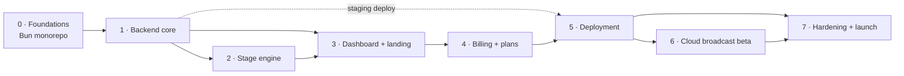

# Implementation plan

**Status:** Proposed · **Date:** 2026-10-16

This plan turns the [architecture](overview.md) and the [ADRs](../adr/README.md)
into phases. Each phase ends in a working, tested state and has exit criteria
that must be met before the next one starts. Nothing is implemented until the
owner accepts the ADRs and answers the [open questions](#open-questions).

## Phases at a glance

| Phase | Outcome | Relative size | ADRs |
|---|---|---|---|
| 0. Foundations | Bun monorepo; v0.1 code moved and passing on Bun; CI on Bun | S | 0002, 0004, 0017 |
| 1. Backend core | Accounts, channels, multi-channel runtimes, realtime hubs, metering; a simulated channel runs end to end through the API | L | 0003, 0005, 0006, 0007, 0008, 0012, 0016 |
| 2. Stage engine | WebGL2 engine and stage page; deterministic visual tests | L | 0009 |
| 3. Dashboard + landing | The whole creator-facing app and the public landing page | XL | 0010, 0011 |
| 4. Billing + plans | Plans, entitlements, Stripe, self-hosted mode | M | 0013 |
| 5. Deployment | Production compose stack, backups, runbook, image publishing | M | 0015 |
| 6. Cloud broadcast (beta) | Server-rendered RTMP streaming, measured capacity | L | 0014 |
| 7. Hardening + launch | Load test, security checklist, performance pass, docs | M | 0016, 0017 |

A **staging deploy** of the Phase 1 backend goes up as soon as Phase 1 is
done, using the Phase 5 compose skeleton, so real TikTok, Claude and
ElevenLabs behavior is measured early (latency, cost per hour, connector on
Bun).

## Phase 0: Foundations

**Deliverables**

- Bun workspaces: `apps/server`, `apps/web`, `packages/shared`, `packages/engine`; `tsconfig.base.json`; root scripts.
- v0.1 `src/` moved into `apps/server/src/runtime/` (see [migration](#migration-from-v01)); event types and persona schema moved into `packages/shared`.
- v0.1 tests ported to `bun test`.
- CI on `oven-sh/setup-bun`: install, typecheck, test.

**Exit criteria**

- `bun install && bun run typecheck && bun test` passes locally and in CI.
- The v0.1 single-channel runner still starts in simulator mode (temporarily kept as `apps/server/src/dev-single.ts`).

## Phase 1: Backend core

**Deliverables**

- Config loader (zod), structured logger with redaction, error shape.
- Drizzle schema and first migration (product tables plus Better Auth tables); `createDb()` for Bun.SQL and PGlite; migrate-at-boot under an advisory lock.
- Better Auth: email and password (argon2id), verification, reset, sessions, rate limits; `Mailer` (console, SMTP, Resend).
- Hono app: middleware chain, `requireUser`, route modules:

| Module | Endpoints |
|---|---|
| `auth` | `/api/auth/*` (Better Auth) |
| `me` | `GET /api/me`, `PATCH /api/me`, `GET /api/me/sessions`, `DELETE /api/me/sessions/:id` |
| `channels` | `GET/POST /api/channels`, `GET/PATCH/DELETE /api/channels/:id`, `POST /api/channels/:id/stage-key/rotate` |
| `runtime` | `POST /api/channels/:id/start`, `/stop`; commands also via the studio socket |
| `analytics` | `GET /api/channels/:id/sessions`, `GET /api/channels/:id/sessions/:sid`, `GET /api/channels/:id/supporters` |
| `stage` | `GET /s/:stageKey` (stage page), `GET /api/stage/:stageKey/audio/:cueId`, `WS /ws/stage/:stageKey` |
| `studio` | `WS /ws/studio/:channelId` |
| `voices` | `GET /api/voices` (curated list) |
| `health` | `GET /healthz`, `GET /readyz` |

- `RuntimeManager` and `ChannelRuntime` (port of v0.1 with per-channel config), `StageHub`, `StudioFeed`, write-behind stores, metering, audience-aware pacing, budgets, per-turn latency metrics.
- Protocol v1 in `packages/shared` with contract tests.
- Crypto utilities (HKDF, AES-GCM, stage-key HMAC).

**Exit criteria**

- Integration tests cover every route, including the cross-tenant suite and auth flows.
- A test creates a user and a simulator channel, starts it through the API, connects a stage socket, receives `speak` cues, acknowledges them, and sees transcript lines on a studio socket.
- Boot-resume test: a channel left running is running again after an app restart in the test harness.
- Shutdown test: write-behind stores flush on stop.
- Manual: a real TikTok LIVE connection works on Bun on staging (or the Node sidecar is built).

## Phase 2: Stage engine

**Deliverables**

- `packages/engine`: resource layer, clock, springs, seeded RNG, quality governor, the atmosphere, motes, offerings, character (orb, voice-line) and UI sprite layers, text rasterizer and layout, audio engine, protocol client.
- `stage.html` entry in `apps/web`.
- Demo driver (a scripted local timeline) for the landing page and the editor's "Try a line".

**Exit criteria**

- Deterministic screenshots for every emotion, alerts, captions and voice-line mode, reviewed and committed as baselines.
- Context loss and restore test passes; no heap growth over a 30 s frame-loop test.
- Stage bundle under 60 KB gzipped.
- Manual OBS checklist: 1080x1920 browser source at 60 fps, audio through OBS, reconnect after a server restart, reload on protocol bump.

## Phase 3: Dashboard and landing

**Deliverables** (screens in build order)

1. Design system: tokens, fonts, primitives on Radix, page shell, command palette, toasts.
2. Auth: sign up, sign in, verify email, reset password.
3. Channels home (rows with live state) and create-channel flow (name, TikTok handle, pick a starter character).
4. **Studio:** stage monitor (embedded engine), "the room" timeline, on-air controls and kill switch, say box, segments, queue, vitals, health, notices. Keyboard shortcuts.
5. **Character editor:** identity, voice (with samples), look (live preview), show segments (reorderable), rules; autosave; "Try a line".
6. Safety: blocklist, strictness, topics; blocked-lines review.
7. Setup: stage URL with copy and rotate, OBS and TikTok LIVE Studio guides; cloud broadcast settings (Phase 6).
8. Analytics: sessions list; a session view with viewers over time, gifts and diamonds, messages, follows, top supporters and host activity.
9. Account: profile, password, sessions (device revoke), delete account.
10. Landing page (prerendered), with the engine in demo mode as the hero.

**Exit criteria**

- E2E: sign up → verify → create channel → start (simulator) → studio shows live transcript → pause → resume → stop; the character editor autosaves and the preview updates.
- Screenshots of every screen at 390, 1280 and 1600 px, critiqued against [ADR-0011](../adr/0011-design-direction.md); issues fixed.
- No accessibility violations from axe in E2E; full keyboard path through the studio.
- Bundle budgets met; landing LCP under 2.0 s (lab).

## Phase 4: Billing and plans

**Deliverables:** `plans.ts`, entitlement service, Stripe Checkout, Portal and
webhooks, enforcement at create, start and the minute ticker, billing page,
upgrade prompts, self-hosted mode.

**Exit criteria:** webhook fixture tests (signature, idempotency, upgrade,
downgrade, payment failure with grace period); enforcement tests;
self-hosted mode test with no Stripe variables set.

## Phase 5: Deployment

**Deliverables:** Dockerfiles, `compose.yaml` (caddy, app, db, backup,
broadcaster profile), Caddyfile, backup script, `deploy/README.md` runbook,
CI image publishing on tags.

**Exit criteria:** fresh-VPS rehearsal following only the runbook reaches a
working HTTPS deployment; backup and restore rehearsal; a deploy interrupts
running channels for under 10 s.

## Phase 6: Cloud broadcast (beta)

**Deliverables:** capacity spike (CPU per stream at 720p and 1080p),
`apps/broadcaster`, broadcast settings UI with write-only stream key, live
status panel, SSRF guard, Chrome H.264 passthrough trial.

**Exit criteria:** a 30-minute soak to a local RTMP server with no audio/video
drift and automatic recovery from a killed ffmpeg; measured capacity recorded
in a follow-up ADR.

## Phase 7: Hardening and launch

**Deliverables:** load test (simulated channels and sockets), security
checklist ([ADR-0016](../adr/0016-security.md)), performance pass (turn latency
p50/p95, frame time, bundle sizes), retention jobs, final docs.

**Exit criteria:** 50 simulated channels on the target VPS with event-loop lag
p99 under 50 ms; checklist complete; all ADRs accepted or superseded.

## Migration from v0.1

| v0.1 file | Destination | Change |
|---|---|---|
| `src/events/types.ts`, `normalize.ts` | `packages/shared/src/events/` | Unchanged logic; shared by server and the dashboard's event rendering |
| `src/events/tiktok.ts`, `simulator.ts` | `apps/server/src/runtime/sources/` | Config injected per channel; simulator becomes the "test mode" source |
| `src/brain/triage.ts`, `director.ts`, `sentences.ts`, `prompt.ts`, `host.ts` | `apps/server/src/runtime/brain/` | Per-channel config; audience-aware pacing; budgets; latency timestamps; metering hooks |
| `src/brain/memory.ts` | `apps/server/src/runtime/memory/` | JSON file replaced by a Postgres-backed cache with write-behind |
| `src/safety/*` | `apps/server/src/runtime/safety/` | Channel safety settings (blocklist, strictness, topics) |
| `src/voice/*` | `apps/server/src/runtime/voice/` | Voice per channel; provider concurrency limiter |
| `src/stage/server.ts` | Split into `StageHub` and `StudioFeed` plus Hono routes | Typed protocol, auth, backpressure |
| `src/obs/supervisor.ts` | Kept as an optional per-channel integration for creators who run their own OBS (post-v1) | |
| `src/config.ts` | `persona` schema to `packages/shared`; env config to `apps/server/src/config.ts` | |
| `public/stage/*` | Replaced by `packages/engine` + `apps/web/stage.html` | Rewritten in WebGL2 |
| `public/control/*` | Replaced by the dashboard studio | Rewritten in React |
| `test/*` | Ported to `bun test` next to their modules | |

## Documentation deliverables

| Document | Audience | Phase |
|---|---|---|
| `docs/architecture/*`, `docs/adr/*` | Contributors | Now; kept current |
| `docs/protocol.md`: realtime protocol reference generated from the zod schemas | Contributors | 1 |
| `docs/api.md`: HTTP API reference | Contributors, future integrators | 1 |
| `deploy/README.md`: runbook (install, configure, upgrade, roll back, back up, restore, harden) | Operators | 5 |
| In-app guides: OBS and TikTok LIVE Studio setup, going live checklist, safety tips | Creators | 3 |
| `CONTRIBUTING.md`: dev setup, scripts, testing rules, ADR process | Contributors | 0 |
| `README.md`: product overview and quick start | Everyone | 0, refreshed at 7 |

## Risks

| Risk | Likelihood | Impact | Mitigation |
|---|---|---|---|
| The unofficial TikTok connector breaks or misbehaves on Bun | Medium | High | `EventSource` interface; verify on staging in Phase 1; Node sidecar fallback; track dropped and unknown events |
| TikTok tightens rules on AI hosts in regular LIVE | Medium | High | Non-removable AI disclosure; ToS excludes Shop LIVE; owner reviews TikTok guidelines before launch |
| AI cost per live hour exceeds what plans can charge | Medium | High | Measured on staging; per-plan models; audience-aware pacing; budgets |
| Stage engine too slow under SwiftShader for broadcast | Medium | Medium | 720p default; quality governor; measure in Phase 2; GPU host option |
| Better Auth or Bun.SQL churn | Low to medium | Medium | Pin versions; full auth and DB integration suites; postgres-js fallback |
| Single VPS failure | Low | High | Nightly backups, rehearsed restore, documented re-provisioning |
| Scope growth delays launch | High | Medium | Phase exit criteria; browser-source mode ships before cloud broadcast |
| Prompt injection gets something harmful on stream | Medium | High | Layered defenses; fail-closed moderation; kill switch; blocked-lines review |

## Open questions

These need the owner's decision. Each has a proposed default that the plan
assumes until answered.

| # | Question | Proposed default |
|---|---|---|
| 1 | Product name | **Lantern** (working name, one constant) |
| 2 | Models per plan, given the [cost table](../adr/0012-ai-and-voice-pipeline.md#cost-model-estimates-to-be-replaced-by-metered-data) (Opus 5.5 host + moderator ≈ $7.55 per live hour; Sonnet 5.5 + Haiku 5.5 ≈ $2.25; Haiku 5.5 for both ≈ $0.20) | Opus 5.5 everywhere until staging measurements are in, then decide per plan |
| 3 | Plan names, prices and limits | Free / Creator / Pro as in [ADR-0013](../adr/0013-billing-and-plans.md), prices TBD |
| 4 | Stripe directly or a merchant of record (Paddle, Lemon Squeezy) for sales tax | Stripe, with the integration isolated |
| 5 | Email provider | Resend (simple HTTP API), SMTP supported |
| 6 | Sign-ups at launch | Invite-only beta, then open |
| 7 | Cloud broadcast in the launch scope | Yes, as a Pro beta after browser-source mode ships |
| 8 | Social sign-in at launch | Email and password only; Google next |
| 9 | Domain for the deployment | Needed before Phase 5 |
| 10 | Delivery: everything on the current branch and PR #1, or one PR per phase | One PR per phase, for reviewable diffs (needs permission to open new branches) |

## Definition of done (every phase)

- Typecheck, unit, integration and contract tests pass; E2E passes for phases that touch the UI.
- Budgets pass (bundle sizes; latency targets where measurable).
- UI screens are screenshot-reviewed at three widths.
- ADR action items for the phase are ticked; any change of direction gets a new ADR.
- Docs for the phase are written (see the [documentation deliverables](#documentation-deliverables)).
